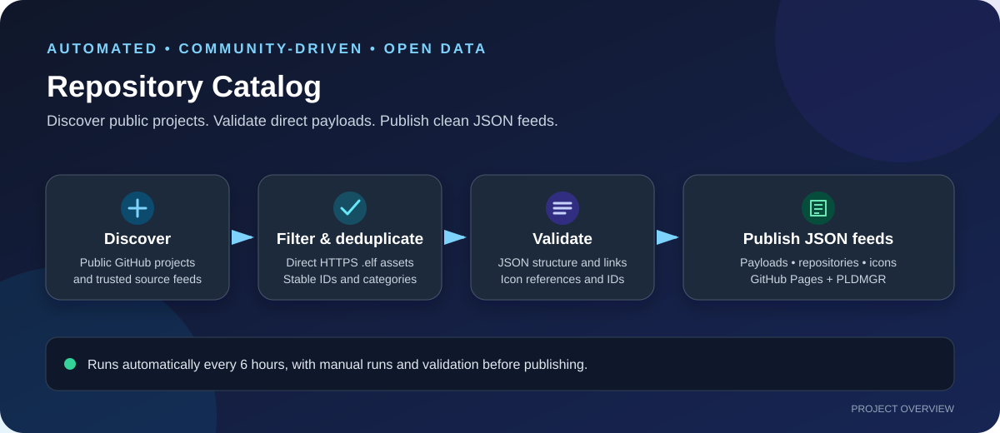

# PS5 Repository Catalog

I created this project to make it easier to find public PlayStation 5 (PS5) homebrew projects and payloads without having to hunt through scattered repositories by hand. The catalog brings information from established community lists together with automatic GitHub discovery, checks the data, and publishes simple JSON feeds that can be consumed by **PLDMGR** and other compatible tools.

The goal is straightforward: **one regularly updated place to discover PS5 projects and reliable direct payload links**. This is a community index, not a claim that every listed project is safe, current, or compatible with every console or firmware.

## Start here

If you're using PLDMGR, use this feed:

**Payload feed:**  
`https://theeteempire.github.io/ps5-repository-catalog/payloads_v2.json`

Other published files:

| Feed | What it contains |
|---|---|
| [`payloads_v2.json`](https://theeteempire.github.io/ps5-repository-catalog/payloads_v2.json) | Payload records with direct HTTPS links to individual `.elf` release assets |
| [`repositories.json`](https://theeteempire.github.io/ps5-repository-catalog/repositories.json) | The broader index of recognized PS5-related public repositories and available metadata |
| [`icons.json`](https://theeteempire.github.io/ps5-repository-catalog/icons.json) | Icon data referenced by the catalog |

The payload feed is the main file to add to PLDMGR. The repository index and icon map are provided for clients that need more context or want to display project icons.

## What happens automatically?

The catalog is generated by GitHub Actions. It runs every six hours and can also be started manually. The workflow follows this general path:

1. **Collect source data.** Read the existing community repository database and the curated payload feed.
2. **Discover more projects.** Search GitHub using several PS5-related terms, including payloads, homebrew, jailbreaks, exploits, ELF files, and general PS5 projects.
3. **Filter and merge.** Skip archived repositories, keep relevant PS5 projects, and avoid adding repository URLs that are already indexed.
4. **Check releases.** Inspect repository releases for individual `.elf` assets and add eligible direct download URLs.
5. **Clean up the catalog.** Deduplicate logical payloads, assign stable unique IDs, apply categories, and connect available icons.
6. **Validate before publishing.** Check the generated JSON, icon mappings, and direct download links before the workflow commits the refreshed data and publishes it through GitHub Pages.

This means the catalog can pick up newly discovered public repositories during future runs, without requiring me to add each repository manually.

## What counts as a payload?

I keep the payload feed focused on **direct HTTPS links to individual files ending in `.elf`**. A repository URL, a GitHub release page, or a ZIP/archive download is not treated as if it were a direct ELF payload.

Some projects distribute their files only inside archives, publish assets outside GitHub Releases, or have no release assets at all. Those projects may still appear in the repository index, but they will not automatically appear as directly downloadable payloads unless a suitable asset can be identified.

The generator also avoids inventing metadata. For example, it does not create fake version numbers, checksums, release tags, or download URLs. A checksum is included only when a trusted upstream source provides one.

## Payload information and quality checks

Where the source data provides it, payload records can include:

- **Name and filename** — a human-readable label and the asset filename.
- **Download URL** — a direct HTTPS URL to the ELF asset.
- **Source information** — the project or repository associated with the payload.
- **Description and category** — context to help organize the catalog.
- **Version and last update** — when supported by the source data.
- **Checksum** — only when supplied by a trusted upstream source.
- **Icon reference** — included when a matching icon is available.

The build checks for duplicate payload identities, unique payload IDs, valid icon references, and valid direct payload URLs. PS4-only binaries are filtered out where they can be identified from the available metadata. If required data or icon mappings fail validation, the workflow should not publish an invalid catalog.

## Categories and icons

Payloads are assigned categories to make the feed easier to browse. Existing curated icons are preferred when available. If a repository has no suitable curated icon, the catalog can use a normalized avatar from its GitHub owner as a fallback. A fallback avatar is not represented as the project's official logo.

The icon feed is keyed by SHA-256 hashes, and the published JSON uses an absolute GitHub Pages URL for `icons_url` so clients do not have to resolve a relative path.

## Sources

This project combines established community data with automated discovery:

- [nexgen999/PS5-Repository-List](https://github.com/nexgen999/PS5-Repository-List) — repository database.
- [itsPLK/ps5-payloads-mirror](https://github.com/itsPLK/ps5-payloads-mirror) — curated payload feed and icon metadata.
- [GitHub Repository Search API](https://docs.github.com/en/rest/search/search#search-repositories) — used to discover additional public PS5-related repositories.

I use these sources to make discovery broader, while keeping the output rules conservative: a project being found does not automatically mean that it has a valid direct payload to publish.

## Automatic updates

- **Schedule:** every six hours.
- **Manual run:** open [Actions](https://github.com/theeteempire/ps5-repository-catalog/actions), select the catalog update workflow, and choose **Run workflow**.
- **Authentication:** the workflow uses GitHub Actions' built-in `GITHUB_TOKEN`; it does not need a personal access token for its normal operation.
- **Publishing:** generated files are validated before being committed, then GitHub Pages serves the public JSON feeds.

You can check the [latest workflow runs](https://github.com/theeteempire/ps5-repository-catalog/actions) to see whether the most recent update succeeded.

## Known limitations

Automated discovery improves coverage, but it cannot guarantee that every relevant repository will be found. GitHub search results depend on repository names, descriptions, README text, indexing, and API limits. Private repositories are not included.

A newly discovered repository may not produce a payload if it has no public release, no individual ELF asset, or uses a distribution method the generator cannot safely interpret. Updates can also be delayed if GitHub's API or an upstream source is temporarily unavailable.

Finally, a direct download link does not guarantee that a payload is safe, maintained, or compatible with a particular PS5 firmware, exploit chain, or setup. **Always read the original project's documentation and release notes before using a payload.** This catalog indexes public project data; it does not modify the payload binaries or independently audit them.

## Contributing

If you know a relevant public PS5 project that is missing, you can open an issue with its repository URL and explain why it belongs in the catalog. Improvements to the discovery terms, filtering, validation, or documentation are also welcome. Please include the original source and avoid submitting unofficial or misleading download links.

---

Made to make PS5 project discovery easier, keep the feeds organized, and reduce the amount of manual maintenance needed.
